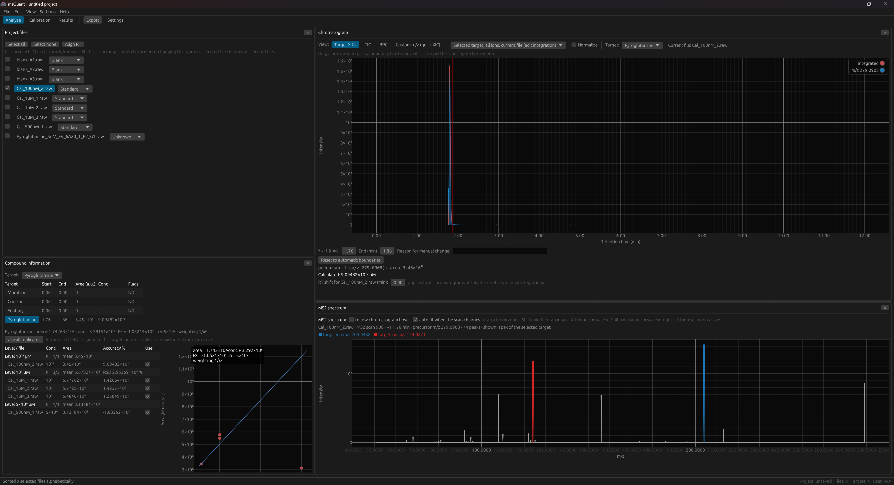

<h1 align="center">msQuant</h1>

<p align="center"></p>

<p align="center">
  <a href="https://github.com/markellerhorst/msQuant/actions/workflows/ci.yml"></a>
</p>

msQuant is a fast, light-weight desktop program (Windows, macOS) for **targeted quantification of LC-MS/MS data** from Thermo `.raw` and mzML files.
You provide a target table (compound, retention time, diagnostic ions); msQuant extracts the chromatograms, integrates the peaks and reports **integrated areas**
or **concentrations from standard curves** measured in the same project. Integration boundaries can be corrected by hand, with a reason that is written to a hash-chained audit trail.

> For method development, research and routine targeted analysis. msQuant offers data-integrity features (audit trail, file hashes, reasons for manual changes)
> but is **not validated or certified** for GxP / 21 CFR Part 11 use.

## Features


- Import of `.raw` (through ThermoRawFileParser) and **mzML**; data stays in memory
- Several targets per project, each with its own standard curve; replicates, per-point exclusion, areas-only mode, results matrix
- **Two peak-finding methods** (legacy and adaptive) to choose from, and manual boundaries per file with a reason
- Quantify on the **MS2 product-ion area** or the **MS1 precursor area**; ion-ratio checks; retention-time alignment
- Dockable panels (files, chromatogram, compound information, MS2 spectrum), light / dark / system theme, savable window layouts, zoom with Ctrl +/-/0
- Hover read-out, zoom box, panning, quick extracted-ion chromatogram for any m/z; export of figures (PNG, SVG) and data (CSV)
- Undo / redo, `.quant` projects that can embed the raw files, settings stored per session and per project

## Build
Requirements: [Rust](https://rustup.rs) 1.85 or newer (edition 2024). On Windows the *Visual Studio Build Tools* ("Desktop development with C++"); on macOS the Xcode command-line tools.

```powershell
git clone https://github.com/markellerhorst/msQuant
cd msQuant
cargo run --release          # or: cargo build --release  -> target/release/msQuant(.exe)
cargo test --no-fail-fast    # tests; real data in test-data/ is optional
```

**Thermo `.raw` files** are read by the separate program [ThermoRawFileParser](https://github.com/CompOmics/ThermoRawFileParser/releases) (CompOmics, Apache-2.0).
It is **not part of msQuant** and never bundled: unzip a release to `tools/ThermoRawFileParser<anything>/` (found automatically) or set its location under
*Settings → Preferences*. The framework-dependent builds need the **.NET 8 runtime**. mzML files need no converter.

## How to use
0. A dialog asks for the m/z window (default 5 ppm), the default saving folder, the integration method (default Savitzky-Golay based *Adaptive*), your user name and whether projects embed the raw files. It opens at the first start (with the location of ThermoRawFileParser) and for every new project; it is pre-filled from your last session.
1. Drop a target table (`.csv`) and your `.raw` / `.mzML` files onto the window (an example is in `examples/target_table_example.csv`).
2. **Calibration** workspace: mark the standard files, give their concentrations per target and check the target table.
3. **Analyze** workspace: check the integrated peaks (drag the boundary lines if needed, give a reason), select the signal and peak method under *Settings → Analysis settings*.
4. **Results** workspace or *Export*: areas and concentrations with flags. Save everything as a `.quant` project.

**Target table** (`name,rt_min,ions`; header optional): `rt_min` in minutes or `n/a` (strongest peak of the run); `ions` are MS2 product ions separated by `;`, the **first is the quantifier**;
an optional `p:<m/z>` gives the MS1 precursor.
```csv
name,rt_min,ions
Morphine,n/a,286.14;201.07;165.05;p:286.1438
Codeine,3.2,300.16;215.10;165.05;p:300.1594
```

Settings (tolerance, RT window, methods, signal, zoom) are remembered for the next session and saved in every project; they can also be saved to a separate file and reset to the defaults (*Settings* menu).

## How quantification works
**1. Extracted-ion chromatogram.** For every scan *s* (MS2 scans in product-ion mode, MS1 scans in precursor mode) at time *t<sub>s</sub>*:
```
I(t_s) = sum of the intensities I_k of all peaks k with |m_k - m0| <= tol,   tol = m0 * ppm * 1e-6   (or tol in Da)
```
The quantifier is the first product ion (or the precursor); the other ions are qualifiers and share the boundaries of the quantifier.

**2. Peak finding** (choose under *Settings → Analysis settings*; boundaries of one peak per target and file).
- *Legacy*: apex = highest point within RT ± window (whole run if the RT is `n/a`); boundaries where the signal falls below 5 % of the apex or rises again on two consecutive points.
- *Adaptive* (Savitzky-Golay, noise- and derivative-based):
  ```
  smoothed  ys_i = (-2 y[i-3] + 3 y[i-2] + 6 y[i-1] + 7 y[i] + 6 y[i+1] + 3 y[i+2] - 2 y[i+3]) / 21
  slope     d_i  = ( sum_{j=-3..3} j * y[i+j] ) / (28 * dt)
  noise     sigma = 1.4826 * MAD(y - ys) / sqrt(2/3)          MAD = median(|r - median(r)|)
  ```
  Candidates are the local maxima of `ys` inside the RT window, ranked by **prominence** (height above the higher of the two lowest points towards the next higher peak).
  The boundaries are where the slope returns to the noise level: `theta = max(3 sigma / (sqrt(28) dt), 0.01 max|d|)`; start = first point left of the apex with `d <= theta`,
  end = first point right of it with `d >= -theta` (this also stops at the valley between overlapping peaks). A peak is accepted if its height above the straight line between the
  boundaries is at least 3 sigma (signal-to-noise 3, the usual limit of detection).
- *Manual*: boundaries typed or dragged; a reason is required and logged; they override either method for that file.

**3. Integration** (trapezoid rule, boundaries `a` and `b` interpolated, time in seconds):
```
A = sum_i (I_i + I_{i+1}) / 2 * (t_{i+1} - t_i)                        area in intensity * s
A_net = A - trapezoid of  B(t) = I(a) + (I(b) - I(a)) * (t - a) / (b - a)    with baseline subtraction
```
The adaptive method always subtracts the straight baseline; for the legacy method it is an option.

**4. Calibration** (mode *Standard curve*, one per target and signal). Points are (concentration *x*, quantifier area *y*) of the included standards; at least two levels.
Weighted least squares `y = m x + b` with weights `w = 1`, `1/x` or `1/x^2`:
```
x_w = sum(w x) / sum(w)      y_w = sum(w y) / sum(w)
m = sum(w (x - x_w)(y - y_w)) / sum(w (x - x_w)^2)       b = y_w - m x_w       R^2 (unweighted)
concentration of a sample = (A - b) / m
```
Flags: *ND* (no peak), *outside cal range*, *PEAK IN BLANK*, *accuracy > 15 %* of a back-calculated standard, *ion ratio fail*
(qualifier / quantifier area outside the mean ratio of the standards ± tolerance), *manual* (hand-set boundaries).

**5. Retention-time alignment** (optional): shift of a run = lag with the highest cross-correlation of its high-pass filtered total-ion chromatogram with the reference run, limited to ± max shift.

## Development principles
- **Follow the [Google Rust Style Guide](https://google.github.io/styleguide/rustguide.html)**: documented items, module-qualified calls, no glob imports; `cargo fmt` (100 columns) before every commit.
- **Avoid external libraries** and prefer a clean, tested re-implementation: SHA-256, zlib, base64, PNG/SVG writers, the mzML reader, the regression and the peak finders are part of this repository.
  Only the GUI (`eframe`/`egui`, `egui_plot`), native file dialogs (`rfd`) and the Windows icon resource (`winresource`) are external.
- **Fast, light-weight and minimalist**: one small executable, no database, no background services, a clean interface without decoration.
- **Layered and testable**: the calculations know nothing about the interface; every layer is tested in `tests/`. See [ARCHITECTURE.md](ARCHITECTURE.md).
- Hostile input is expected: no `unsafe`, bounded decoders, checked lengths, no shell. ThermoRawFileParser is looked up only in the preferences, `$THERMO_RAW_FILE_PARSER` and `tools/`.

## Credits
- [ThermoRawFileParser](https://github.com/CompOmics/ThermoRawFileParser) (CompOmics, Apache-2.0), used as an external program; Thermo RawFileReader libraries are subject to Thermo's license.
- [egui / eframe / egui_plot](https://github.com/emilk/egui) (MIT / Apache-2.0), [rfd](https://github.com/PolyMeilex/rfd) (MIT), `winresource` (MIT), see `THIRD_PARTY_NOTICES.md`.
- Application icon `img/msQuant-ico.*`.
- msQuant is released under the MIT license (`LICENSE`).
